# Apex

A native iOS app that combines Apple Watch health data, workout and meal logging, an AI daily plan and a chat coach. SwiftUI + SwiftData, no backend of its own.

## Features

| Tab | What the code does |
|---|---|
| **Today** | A dashboard: the next block of your day with a swipeable plan, quick actions (log workout, snap a meal, ask the coach), tiles for activity, recovery, nutrition and training that open detail sheets, the focus timer and your next calendar event |
| **Workouts** | A week strip of seven day chips (done, missed, planned) that open a day sheet, log tennis and gym sessions, a Train next card with swipeable muscle chips linking to the muscle map, the last four sessions with See all, and Apple Watch import |
| **Nutrition** | A 7-day strip with a calorie bar per day (tap to pick a day), a big calorie total with a protein, carbs and fat split bar, Snap a meal and Type it out, and the day's meals; calorie and macro numbers are AI estimates |
| **Progress** | A level hero, a 14-day strip of days you logged something, tiles for the workout streak, meal streak, achievements and the "Muscles Worked" heatmap, then all-time stats and a workout type breakdown |
| **Coach** | Chat with the AI. The system prompt tells it to answer from your numbers (calories and protein left, HRV vs 7-day average, sleep) |

Also: morning and evening check-ins, XP for logging, a local notification at 8pm when a streak is at risk or nothing is logged, GitHub commits for today (public events API, username set in Settings).

## Screenshots

Dark mode:

<p>
  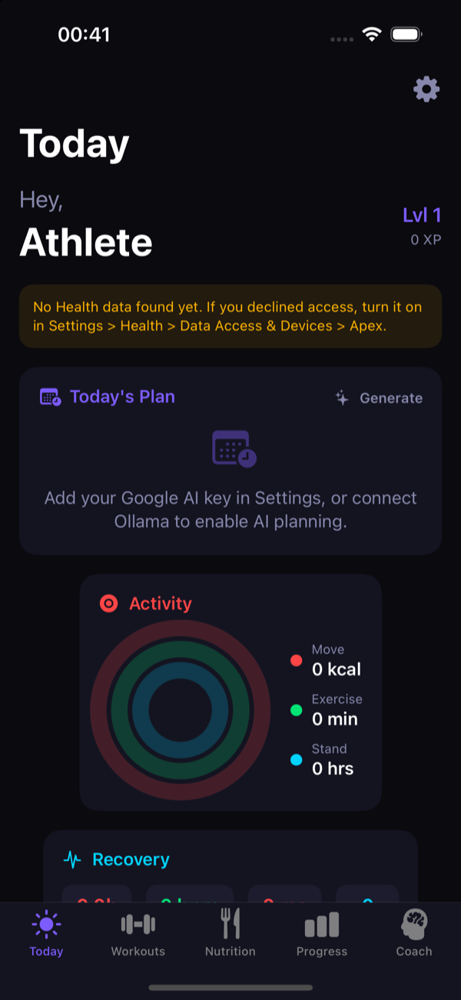
  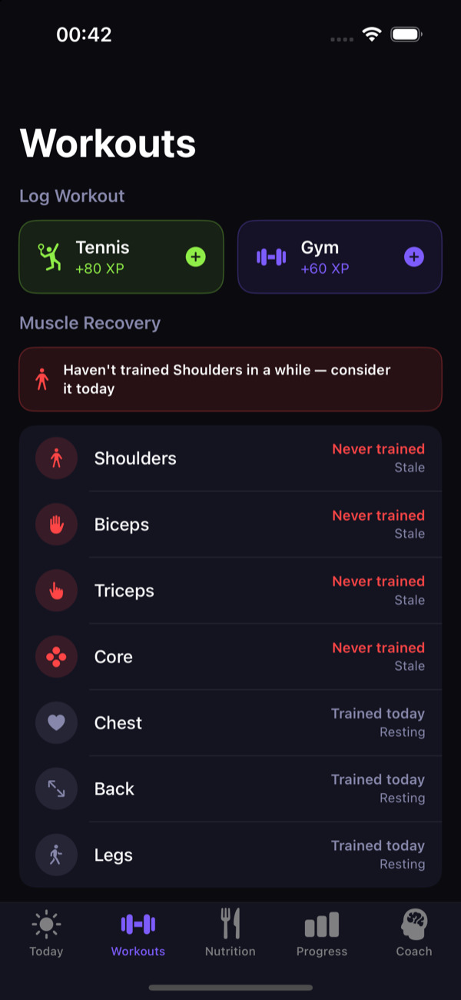
  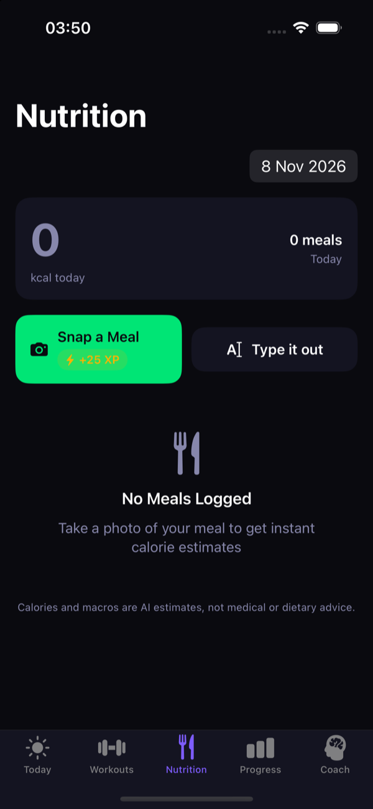
  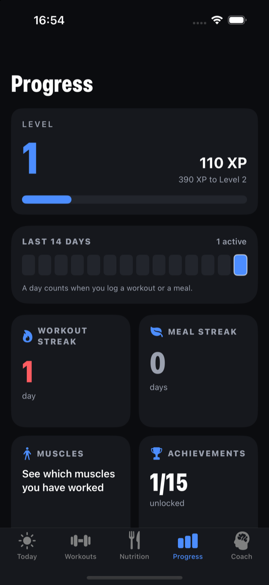
</p>
<p>
  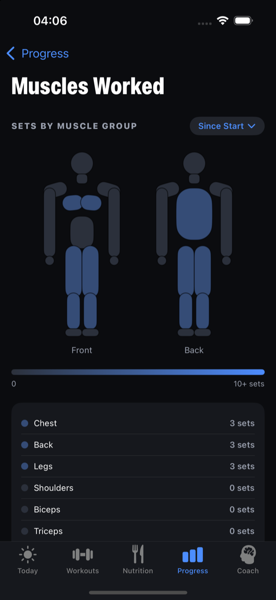
  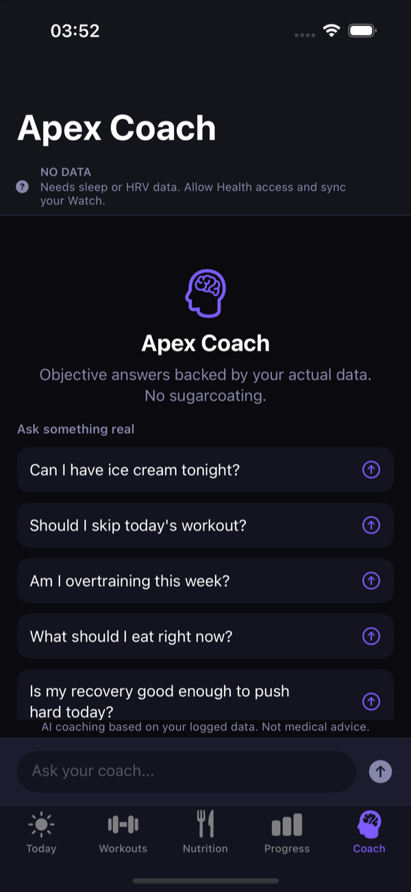
  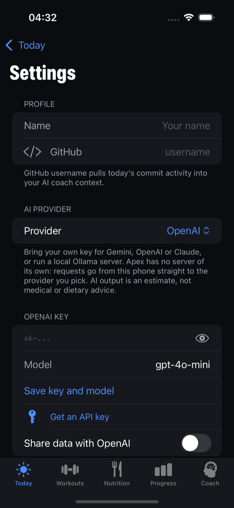
</p>

Light mode (the app follows the system setting):

<p>
  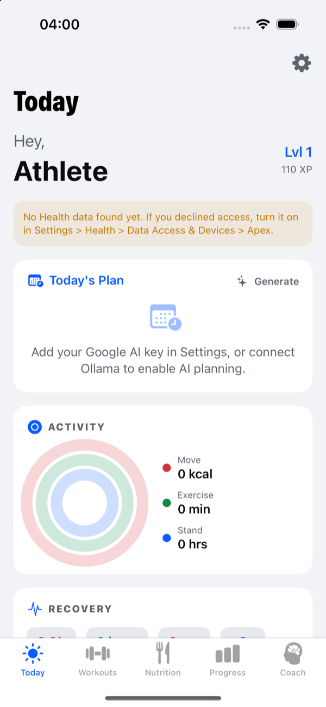
  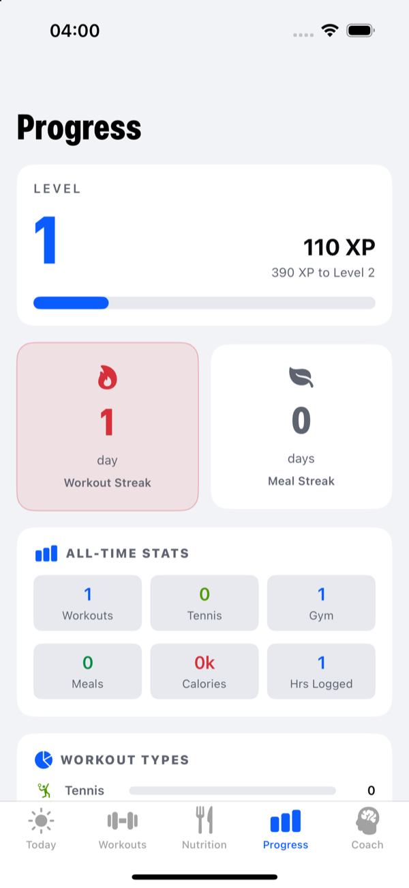
  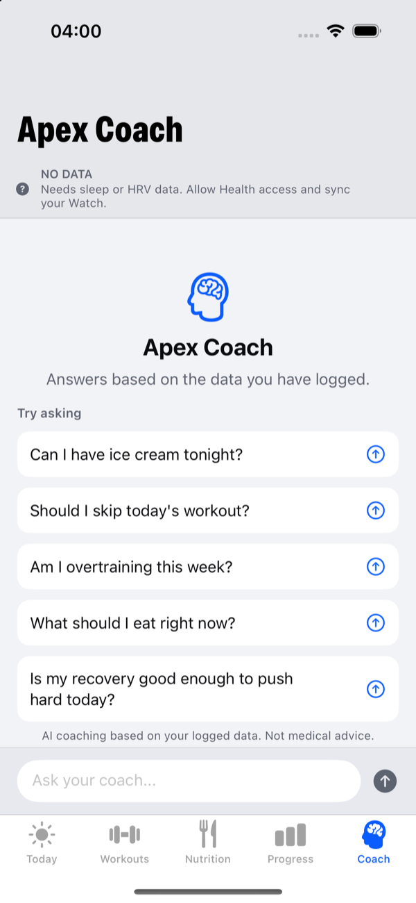
  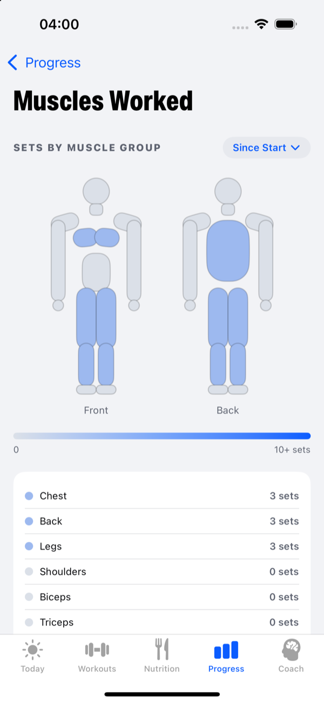
</p>

Taken on the iOS 18.0 simulator, so there is no Health data (rings and recovery numbers read 0 or "No data") and no API key. The Workouts, Progress and Muscles Worked screens show one logged gym workout: bench press, pull-up and back squat, 3 sets each. The plan on the Today screenshots is a hand-written sample, not AI output, because no API key was set. The Settings screenshot shows the provider picker with OpenAI selected and no key.

## AI services

You pick one provider in Settings and bring your own key. Apex has no server of its own: requests go from the phone straight to the provider.

| Provider | Default model | Photos | Notes |
|---|---|---|---|
| Google Gemini | `gemini-2.5-flash` | yes | key from Google AI Studio |
| OpenAI | `gpt-4o-mini` | yes | chat completions API |
| Anthropic Claude | `claude-haiku-5-5` | yes | messages API |
| Local (Ollama) | `llama3.2` | no | your own server, nothing leaves your network |

The model name is editable per provider. Once a key is saved, Settings asks the provider which models that key can use and turns Model into a picker, so you never have to guess a name; picking one saves it at once. If the list can't load, Model falls back to free text and the provider's error is shown with a Reload models button. **Test connection** sends a tiny request with no personal data and shows the provider's own error text. A 404 almost always means the saved model was retired; the picker flags a saved model the key can't use. Keys are stored in the iOS Keychain, one per provider, and are sent in request headers, never in a URL. Sharing is a separate switch per cloud provider and is off until you turn it on. Meal photo analysis needs a cloud provider; with Local, use Type it out.

Reasoning models spend tokens thinking before the visible reply, so Gemini, OpenAI and Local requests get 1,200 extra tokens of headroom. I checked this for Ollama with the same request shape sent by `curl` to `gpt-oss:20b` (valid JSON back at a 1,500 token limit, empty reply at 300). A paid "Apex AI" option could be added later as one more provider.

Verified by tests only: each provider's request shape (URL, headers, body, image block) and reply parsing, offline. Not yet run against the real OpenAI, Anthropic or Gemini APIs, or against an Ollama server from the app itself. The class is still named `ClaudeService` for historical reasons and is provider-neutral.

## Stack

- SwiftUI, SwiftData (iOS 17+)
- HealthKit (read only), EventKit (calendar, read only), UserNotifications
- XcodeGen (`project.yml`) to generate `Apex.xcodeproj`

## Project structure

```
Apex/
  Models/     SwiftData models and enums
  Services/   HealthKitService, ClaudeService (Gemini + Ollama), GamificationService, CalendarService, GitHubService, FocusTimerService, NotificationService
  Views/      One folder per tab plus Morning, Evening, Settings, Components
  Data/       Exercise and tennis drill lists
  Utils/      Constants, extensions, MuscleGroupTracker
```

## Getting started

See [SETUP.md](SETUP.md). In short: Xcode 15.2 or newer, an iOS 17+ device (HealthKit data needs a real device), and a free Google AI Studio API key.

```bash
xcodegen generate   # optional, the .xcodeproj is committed
open Apex.xcodeproj
```

Add your name, then choose an AI provider and add its key in Settings.

## Status

- Builds with Xcode 27.2 for the iOS 18.0 simulator.
- Unit tests: 40 run, 40 pass, 0 fail (iOS 18.0 simulator). Run them ad-hoc signed, because the Keychain test needs an entitlement that unsigned builds lack: `xcodebuild test -project Apex.xcodeproj -scheme Apex -destination 'platform=iOS Simulator,name=<your simulator>' CODE_SIGN_IDENTITY=- CODE_SIGNING_ALLOWED=YES CODE_SIGNING_REQUIRED=NO`. With `CODE_SIGNING_ALLOWED=NO` the Keychain test fails (last unsigned run: 21 tests, 4 failures, all that test). They cover the data and logic layer only: levels, streaks, XP, achievements, muscle tracker, exercise list, meal JSON parsing, AI consent gate, error messages, Keychain storage and migration, and missing-Health-data handling, that every Health type the app reads is in the permission list, the muscle figure regions, the heat scale, each AI provider's request and reply handling (offline), which plan block is next, provider error text and model lists, weekly plan progress, the macro split, and the 14-day active strip.
- Not covered by tests and not verified by me: HealthKit and Apple Watch data, the 8pm notification, camera, calendar, GitHub, and real calls to Gemini, OpenAI, Claude or Ollama. These need a device, a key or a local server.
- No XP for completing the daily plan, closing rings or logging sleep.
- The calorie and protein targets are rough rules (weight x 33 kcal, weight x 1.8 g), not a validated formula, and are 0 when Health has no weight.
- The sleep score is a simple home-made formula from sleep hours and HRV.
- Seen on a simulator screen (iOS 18.0): app icon, first-run Health, notification and calendar prompts, the check-in with Health denied, the Today notice, the Workouts muscle recovery list, Nutrition, Progress, the Muscles Worked heatmap, Coach (the banner shows No Data until there is a sleep or HRV reading) and Settings (including the Gemini sharing switch). Both light and dark mode were checked on Today, Progress, Muscles Worked, Coach and Settings; the other screens (check-ins, workout logging sheets, camera) were not checked in light mode. The Today dashboard, the new figure, the blue to red heat scale and the provider picker were seen in both modes except Settings, which was seen in dark mode. Test connection and the automatic model load were run from the simulator with a fake OpenAI key and showed OpenAI's real 401 message. The picker itself was seen only with an injected sample list (removed afterwards). I have not run any of this with a valid key for any provider, so what the real Gemini, OpenAI or Claude lists contain is untested. Not seen: any real AI reply.
- Not yet done for an App Store release: a hosted privacy policy URL (the text is in PRIVACY.md), a support URL (the GitHub issues page can serve), App Store listing and TestFlight setup (needs an Apple Developer account and a team ID).

History and design notes are in [DEVLOG.md](DEVLOG.md).

## Privacy

See [PRIVACY.md](PRIVACY.md).

## License

MIT, see [LICENSE](LICENSE).
